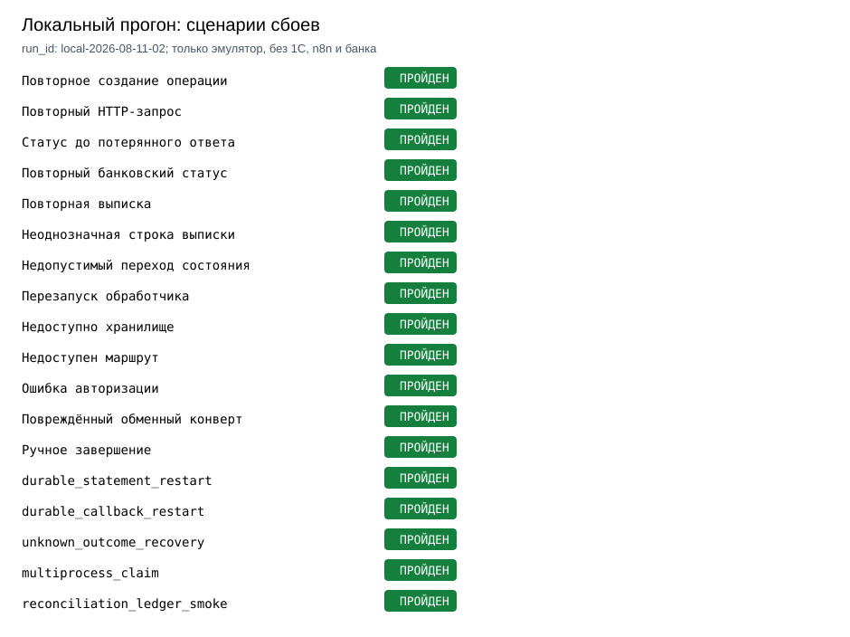

# Платёжный контур 1С: повторы, статусы, сверка

[](https://github.com/sergey-lastochkin/payment-integration-control-plane/actions/workflows/ci.yml)

схема «1С → н8н → банк → статус обратно в 1С», которая не отправит платёжку дважды и не потеряет её статус, даже когда сеть, банк или воркер ведут себя плохо.



простое «отправили платёжку, пометили оплаченной» ломается на первом же живом сбое. ответ банка потерялся уже после отправки. статус пришёл дважды или раньше самого ответа. выписку загрузили второй раз. одна строка выписки подходит сразу к двум платежам. а дальше либо двойной платёж, либо ложное «исполнено».

я разделил саму операцию и попытку её доставить. у каждой платёжки один `operation_id`, и повторный запрос второй отправки не создаёт. статус меняется только по разрешённым переходам, и для Python и BSL это одна спецификация. если после сбоя непонятно, ушёл платёж или нет, операция становится `outcome_unknown`, и вслепую повторить её нельзя, только после запроса статуса, сверки или ручного решения. входящие ответы банка и строки выписки лежат в SQLite и повторно не применяются, даже после перезапуска.

## проверка на сбоях

сохранённый прогон [local-2026-08-11-02](failure_lab/runs/local-2026-08-11-02/summary.json), прошли 18 из 18:

| что случилось | что получилось |
|---|---|
| два одинаковых HTTP-запроса | одна операция и один файл на отправку |
| статус пришёл раньше ответа отправителя | `accepted` не перетирается более слабым `sent` |
| банк прислал статус повторно | в аудите одна запись `accepted` |
| выписку загрузили снова после перезапуска | вторая строка отдаётся с `replayed=true` из SQLite |
| строка выписки подходит к двум платежам | уходит на ручную проверку |
| потерялся ответ после отправки | после перезапуска `outcome_unknown`, слепого повтора нет |
| два воркера одновременно | отправляет только один |
| решили вручную | у финального статуса источник `manual_resolution` |

через настоящий HTTP с н8н ([summary.json](real_run/runs/local-n8n-bank-2026-08-11/summary.json)) прошли 8 из 8: обычный маршрут, повторная отправка, задержка ответа, статус раньше ответа, повторный и противоречивый статус, потеря ответа после того, как банк уже принял, с восстановлением через запрос статуса.

## запуск

```bash
git clone https://github.com/sergey-lastochkin/payment-integration-control-plane.git
cd payment-integration-control-plane
python3.11 -m venv .venv
.venv/bin/pip install -e '.[dev]'

PYTHONPATH=src .venv/bin/python -m pytest -q
PYTHONPATH=src .venv/bin/python failure_lab/run.py --run-id local-demo-01
PYTHONPATH=src .venv/bin/python failure_lab/restart_demo.py
```

`run.py` гоняет 18 сценариев во временной папке и печатает `{"run_id": "local-demo-01", "passed": 18}`, подробности по каждому остаются в `failure_lab/runs/local-demo-01/`. `restart_demo.py` показывает, как после перезапуска `sending` становится `outcome_unknown` и повторных отправок ноль. SVG-отчёт рисует `failure_lab/render_report.py`.

полный маршрут через н8н (нужен Docker, n8n `1.82.3`, контур и эмулятор банка):

```bash
PYTHONPATH=src .venv/bin/python real_run/local_stack/run_e2e.py \
  --run-id local-n8n-demo-01 \
  --public-output real_run/runs/local-n8n-demo-01/summary.json
```

как устроено подробнее: [жизненный цикл платежа](docs/payment-lifecycle.md), [сверка выписки](docs/reconciliation.md), [модель сбоев](docs/failure-model.md), [решения](docs/adr/), [прогон через н8н](docs/real-integration-validation.md).

## где границы

банк тут - эмулятор. настоящие банковские API, DirectBank и штатный обмен 1С я не подключал, адаптер под конкретный банк пишется по его контракту. `bsl/PaymentIntegration.bsl` показывает точки интеграции на синтетической конфигурации, имена метаданных надо сопоставить с вашей базой, в 1С модуль не запускался. SQLite рассчитан на один сервер, для нескольких нужна общая база. веса сопоставления выписки подобраны на глаз и на реальных данных не откалиброваны. все реквизиты в тестах выдуманы, документов, ИНН, счетов, адресов серверов и ключей в репозитории нет.

нужно довести платёжный обмен в вашей базе до такого состояния - пишите в Telegram [t.me/metaanswer](https://t.me/metaanswer). Сергей Ласточкин.
